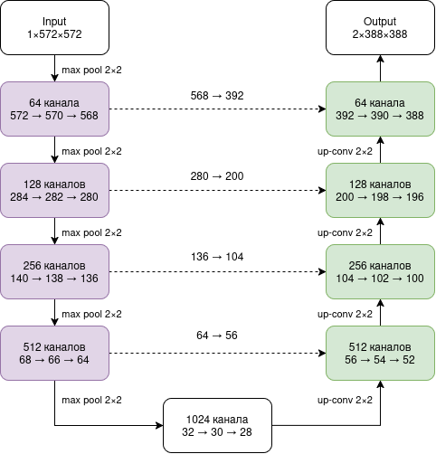
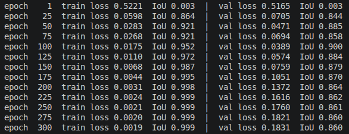
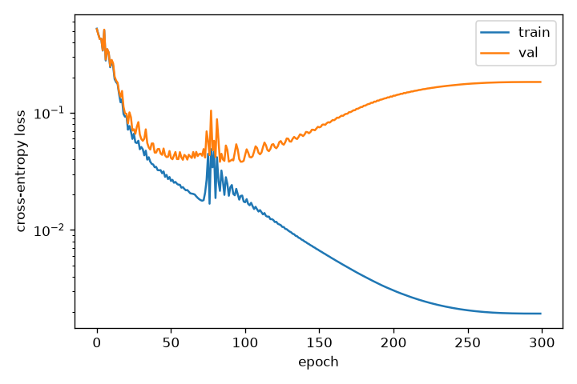
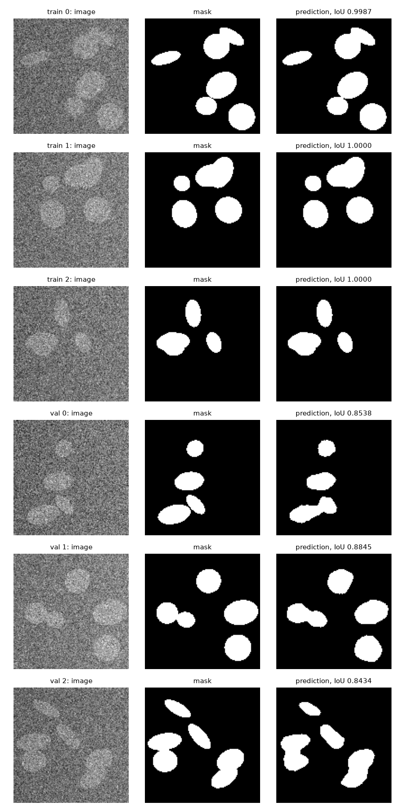

# Восстановление пространственных деталей в архитектуре U-Net

**Материал:** O. Ronneberger, P. Fischer, T. Brox. U-Net: Convolutional Networks for Biomedical Image Segmentation. MICCAI, 2015.

## 1. Предложение авторов и отличия от FCN

**Задача.** В биомедицинской сегментации требуется метка для каждого пикселя, а размеченных изображений обычно несколько десятков. Предшествующий подход Ciresan et al. классифицировал каждый пиксель по окружающему фрагменту изображения. Он работал медленно из-за повторных вычислений на перекрывающихся фрагментах и вынуждал выбирать между объёмом контекста и точностью локализации.

**Предложение авторов.** За основу взята полностью свёрточная сеть Long et al. (FCN), которая доработана в четырёх направлениях.

1. *Симметричная архитектура.* Сеть состоит из сужающейся части, собирающей контекст, и расширяющейся части, восстанавливающей разрешение. На каждом шаге расширяющейся части карта признаков увеличивается свёрткой 2×2 (up-convolution) с уменьшением числа каналов вдвое, объединяется конкатенацией с картой соответствующего уровня сужающейся части и обрабатывается двумя свёртками 3×3. Расширяющаяся часть содержит много каналов, поэтому контекст передаётся в слои высокого разрешения, а сеть приобретает U-образную форму.
2. *Свёртки без дополнения нулями и обработка плитками.* Полносвязные слои отсутствуют, свёртки не дополняют вход нулями, поэтому каждый пиксель выхода опирается на полный контекст. Изображения произвольного размера обрабатываются перекрывающимися плитками (overlap-tile), а контекст у границы изображения достраивается зеркальным отражением.
3. *Обучение на малой выборке.* Основным средством служит аугментация случайными упругими деформациями, дополнительно используется dropout в конце сужающейся части. Сеть обучается с нуля; начальные веса выбираются из нормального распределения со стандартным отклонением √(2/N).
4. *Взвешенная функция потерь.* Используется попиксельная кросс-энтропия с картой весов, которая выравнивает частоты классов и придаёт большой вес узким промежуткам фона между соприкасающимися объектами.

Сеть заняла первое место по warping error (0,000353) на соревновании ISBI 2012 по сегментации нейронных структур и победила на соревновании ISBI 2015 по трекингу клеток со средним IOU 92% (PhC-U373) и 77,5% (DIC-HeLa).

**Отличия архитектуры от FCN.**

| Признак | FCN-8s | U-Net |
| --- | --- | --- |
| Сужающаяся часть | VGG16, предобученная на ImageNet; до 512 каналов | обучается с нуля; от 64 до 1024 каналов |
| Расширяющаяся часть | только транспонированные свёртки | на каждом уровне up-conv 2×2 и две свёртки 3×3 |
| Что передаётся по связям | карты оценок классов (21 канал) после свёртки 1×1 | полные карты признаков (от 64 до 512 каналов) |
| Способ объединения | поэлементное сложение | конкатенация по каналам |
| Число объединений | 2 (pool4, pool3) | 4, на каждом уровне |
| Классификация пикселей | на каждом объединяемом уровне | один раз, свёрткой 1×1 на выходе |
| Свёртки | с дополнением, вход дополняется на 100 пикселей | без дополнения, копируемые карты обрезаются |
| Размер выхода | равен размеру входа | меньше входа (388 при входе 572) |

Главное различие состоит в месте принятия решения о классе. FCN классифицирует пиксели уже на промежуточных уровнях и затем только складывает и увеличивает готовые оценки. U-Net передаёт в расширяющуюся часть сами признаки, обрабатывает их свёртками на каждом уровне и выполняет классификацию один раз в конце, что позволяет точнее восстанавливать границы объектов.

## 2. Схема уменьшения и увеличения разрешения

**Уменьшение разрешения.** Каждый уровень сужающейся части выполняет две свёртки 3×3 без дополнения, каждая из которых уменьшает высоту и ширину на 2 пикселя, и max pooling 2×2 с шагом 2, уменьшающий размер вдвое. Число каналов удваивается на каждом уровне: 64, 128, 256, 512 и 1024 на нижнем уровне. При входе 572×572 карта нижнего уровня имеет размер 28×28.

**Увеличение разрешения.** Каждый уровень расширяющейся части увеличивает карту в 2 раза с помощью up-conv 2×2 и вдвое уменьшает число каналов. После объединения две свёртки 3×3 снова уменьшают размер на 4 пикселя. Последняя свёртка 1×1 переводит 64 канала в 2 класса. Выход имеет размер 388×388.

**Места объединения признаков.** Объединение выполняется в четырёх местах, отмеченных на схеме номерами. Так как свёртки не дополняют вход нулями, карта сужающейся части больше карты расширяющейся части того же уровня и обрезается по центру.

| Уровень | Карта энкодера | После обрезки | Карта после up-conv | Каналов после конкатенации | Каналов после двух свёрток |
| --- | --- | --- | --- | --- | --- |
| 1 | 64 × 568 × 568 | 64 × 392 × 392 | 64 × 392 × 392 | 128 | 64 |
| 2 | 128 × 280 × 280 | 128 × 200 × 200 | 128 × 200 × 200 | 256 | 128 |
| 3 | 256 × 136 × 136 | 256 × 104 × 104 | 256 × 104 × 104 | 512 | 256 |
| 4 | 512 × 64 × 64 | 512 × 56 × 56 | 512 × 56 × 56 | 1024 | 512 |

Связи передают в расширяющуюся часть признаки высокого разрешения, утраченные при пулинге, а свёртки после конкатенации учатся сочетать их с контекстом, поступающим с нижних уровней. Именно этот механизм обеспечивает точную локализацию границ.

## 3. Программная реализация

**Данные.** Для проверки конвейера обработки данных используется синтетическая выборка, разметка которой заведомо верна. Каждое изображение размером 128×128 содержит от 3 до 6 эллипсов («клеток») случайного размера, положения и ориентации. Яркость фона составляет 0,3, яркость клеток на 0,35 выше; добавлены плавный перепад освещения и нормальный шум со стандартным отклонением 0,3. Маска содержит номер класса для каждого пикселя (0 для фона, 1 для клетки). Доля пикселей переднего плана равна 0,139. Классификация пикселей по яркости без учёта окрестности даёт IoU 0,27, поэтому для сегментации требуется контекст. Обучающая и проверочная выборки содержат по 4 изображения и генерируются с разными начальными значениями генератора случайных чисел. Перед обучением проверяются совпадение размеров изображений и масок, целочисленный тип масок и допустимый диапазон их значений.

**Модель** (файл `u_net.py`) повторяет структуру U-Net в уменьшенном виде:

* сужающаяся часть из трёх уровней и нижнего блока; каждый уровень содержит две свёртки 3×3 с функцией активации ReLU и max pooling 2×2, число каналов удваивается от 16 до 128;
* расширяющаяся часть из трёх уровней; каждый уровень содержит транспонированную свёртку 2×2 с шагом 2, уменьшающую число каналов вдвое, конкатенацию с картой признаков соответствующего уровня сужающейся части и две свёртки 3×3 с ReLU;
* свёртку 1×1, переводящую 16 каналов в 2 класса;
* инициализацию весов свёрток из нормального распределения со стандартным отклонением √(2/N), как в статье.

Модель содержит 482 тыс. параметров, тогда как полноразмерная U-Net содержит 31 млн. В отличие от статьи, свёртки дополняют вход нулями, поэтому выход совпадает по размеру со входом и обрезка копируемых карт не требуется.

**Обучение.** Функция потерь представляет собой попиксельную кросс-энтропию, что соответствует формуле 1 статьи при единичной карте весов. Используется оптимизатор Adam с начальной скоростью обучения 10⁻³, которая уменьшается до нуля по косинусному закону за 300 эпох. Все 4 обучающих изображения образуют один батч. Аугментация не применяется, поскольку цель эксперимента состоит в запоминании обучающей выборки. После обучения восстанавливаются веса с наименьшей потерей на обучающей выборке.

## 4. Результаты обучения

**Таблица 1.** Потеря и IoU на обучающей и проверочной выборках.

**Рисунок 1.** Потеря на обучающей и проверочной выборках (логарифмическая шкала).

**Рисунок 2.** Изображения, разметка и предсказания для трёх обучающих (верхние строки) и трёх проверочных (нижние строки) изображений.

На обучающих изображениях предсказание совпадает с разметкой (IoU 1,00), включая границы соприкасающихся клеток. На проверочных изображениях IoU составляет от 0,85 до 0,9. Основной тип ошибок состоит в слиянии соприкасающихся клеток в одну область (изображения val 0 и val 1). Именно для этого случая авторы U-Net вводят карту весов, придающую большой вес узким промежуткам фона между соседними объектами (формула 2 статьи).

В предварительном запуске с постоянной скоростью обучения на 228-й эпохе наблюдался резкий рост потери на обучающей выборке с 0,0015 примерно до 2 с частичной потерей запомненного решения. Уменьшение скорости обучения по косинусному закону устранило эту неустойчивость.
