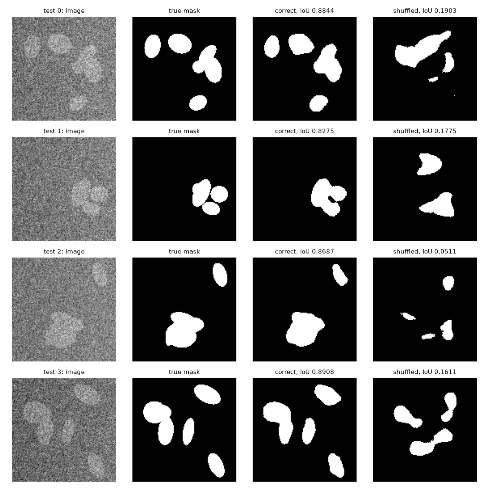
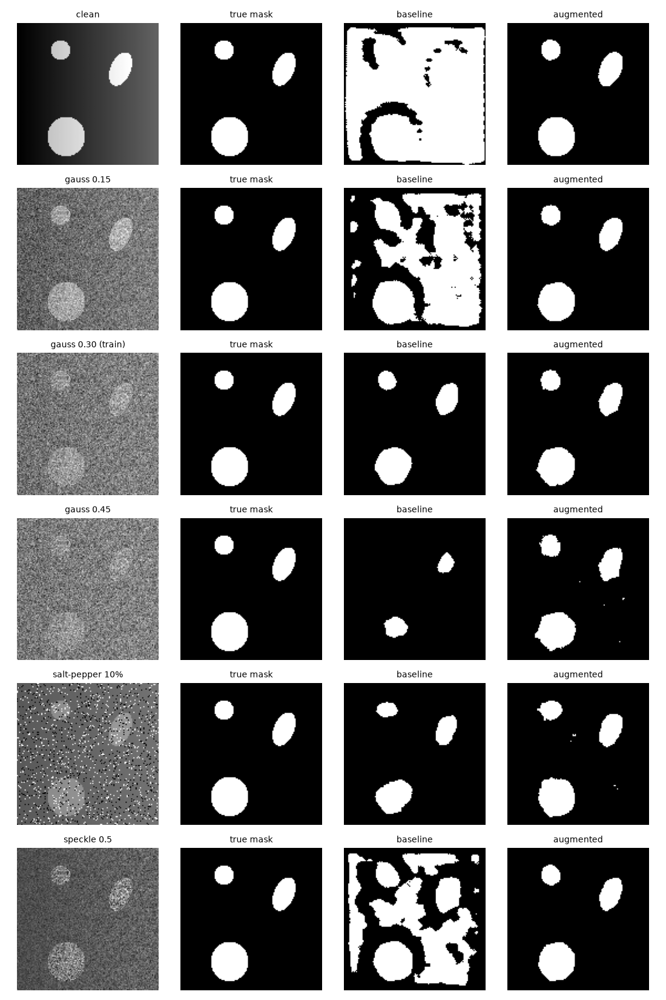

# Восстановление пространственных деталей в архитектуре U-Net

**Материал:** O. Ronneberger, P. Fischer, T. Brox. U-Net: Convolutional Networks for Biomedical Image Segmentation. MICCAI, 2015.

## Ответы на вопросы

1. Слияние соседних клеток
   
Первоначальный вывод о том, что слияние соприкасающихся клеток является основной ошибкой модели, был неточным. Генератор рисует все эллипсы в одной бинарной маске, поэтому перекрывающиеся клетки уже в разметке образуют одну область. 

Предсказание сравнивается не с видом клеток на изображении, а со связными областями маски. Для каждой связной области предсказания определяется, сколько областей разметки она покрывает. Если в разметке клетки уже образуют одну область, объединённое предсказание воспроизводит разметку. Ошибкой слияния является случай, когда область предсказания соединяет две области разметки, разделённые фоном. Узкие полосы фона между разными областями разметки (не дальше 3 пикселей от обеих) составляют 0,26% площади клеток, поэтому даже их полное заполнение снижает IoU не более чем на 0,003. Метрика IoU к таким ошибкам почти не чувствительна, и для их оценки нужна метрика по отдельным клеткам.

*Эксперимент с функцией потерь.*

1. Изменить генератор: сохранять номер каждого эллипса и разделять соприкасающиеся клетки в маске полосой фона шириной 1 или 2 пикселя, как в разметке данных статьи.
2. По номерам клеток вычислить карту весов по формуле 2 статьи, w(x) = w_c(x) + w_0·exp(−(d_1 + d_2)² / 2σ²), с w_0 = 10 и σ около 5 пикселей.
3. Обучить две модели с одинаковыми начальными весами, данными и числом эпох: с обычной и со взвешенной кросс-энтропией.
4. Сравнить их на новых изображениях по IoU, по доле пикселей полос между клетками, отнесённых к фону, и по числу пар клеток, объединённых в одну область.

Если взвешенная функция потерь решает проблему, то при близком IoU она сохранит больше полос фона и разделит больше пар клеток.

3. Обучение или запоминание
   
IoU на обучающей выборке показывает, что сеть способна уменьшить потерю, и не проверяет, соответствуют ли маски изображениям. Для такой проверки поставлен контрольный эксперимент с перемешанными масками. Две модели с одинаковыми начальными весами и числом эпох обучаются на одних и тех же 4 изображениях: первая с правильными масками, вторая с масками других изображений. Обе оцениваются по правильным маскам на 4 проверочных и 50 новых тестовых изображениях.

Ожидаемые результаты:

запоминает: на обучающей выборке IoU высокий, а на проверочной низкий, на уровне модели с перемешанными масками. Так же выглядел бы результат, если бы маски в конвейере были случайно перепутаны.
обучается: на обучающей выборке IoU высокий у обеих моделей, а на проверочной правильная модель заметно лучше перемешанной и лучше порога по яркости.

| Модель | Обучение (4) | Проверка (4) | Тест (50) |
| --- | --- | --- | --- |
| правильные маски | 0,999 | 0,86 | 0,874 |
| перемешанные маски | 0,967 | 0,12 | 0,132 |
| порог по яркости, без сети | 0,267 | 0,259 | 0,244 |

Результат соответствует второму случаю. Обе модели запоминают свои обучающие маски, но на новых изображениях правильная модель даёт 0,874, а перемешанная 0,132. Потеря перемешанной модели на обучении около 125 эпох почти не снижалась, после чего модель начала заучивать маски поточечно. Следовательно, маски соответствуют изображениям, а сеть выучила связь между изображением и разметкой. Правильная модель также значительно превосходит порог по яркости (0,874 против 0,244), то есть использует окрестность пикселя, а не только его яркость. Дополнительная проверка приведена в разделе 5.

## 1. Предложение авторов и отличия от FCN

**Задача.** В биомедицинской сегментации требуется метка для каждого пикселя, а размеченных изображений обычно несколько десятков. Предшествующий подход Ciresan et al. классифицировал каждый пиксель по окружающему фрагменту изображения. Он работал медленно из-за повторных вычислений на перекрывающихся фрагментах и вынуждал выбирать между объёмом контекста и точностью локализации.

**Предложение авторов.** За основу взята полностью свёрточная сеть Long et al. (FCN), которая доработана в четырёх направлениях.

1. *Симметричная архитектура.* Сеть состоит из сужающейся части, собирающей контекст, и расширяющейся части, восстанавливающей разрешение. На каждом шаге расширяющейся части карта признаков увеличивается свёрткой 2×2 (up-convolution) с уменьшением числа каналов вдвое, объединяется конкатенацией с картой соответствующего уровня сужающейся части и обрабатывается двумя свёртками 3×3. Расширяющаяся часть содержит много каналов, поэтому контекст передаётся в слои высокого разрешения, а сеть приобретает U-образную форму.
2. *Свёртки без дополнения нулями и обработка плитками.* Полносвязные слои отсутствуют, свёртки не дополняют вход нулями, поэтому каждый пиксель выхода опирается на полный контекст. Изображения произвольного размера обрабатываются перекрывающимися плитками (overlap-tile), а контекст у границы изображения достраивается зеркальным отражением.
3. *Обучение на малой выборке.* Основным средством служит аугментация случайными упругими деформациями, дополнительно используется dropout в конце сужающейся части. Сеть обучается с нуля; начальные веса выбираются из нормального распределения со стандартным отклонением √(2/N).
4. *Взвешенная функция потерь.* Используется попиксельная кросс-энтропия с картой весов, которая выравнивает частоты классов и придаёт большой вес узким промежуткам фона между соприкасающимися объектами.

Сеть заняла первое место по warping error (0,000353) на соревновании ISBI 2012 по сегментации нейронных структур и победила на соревновании ISBI 2015 по трекингу клеток со средним IOU 92% (PhC-U373) и 77,5% (DIC-HeLa).

**Отличия архитектуры от FCN.**

| Признак | FCN-8s | U-Net |
| --- | --- | --- |
| Сужающаяся часть | VGG16, предобученная на ImageNet; до 512 каналов | обучается с нуля; от 64 до 1024 каналов |
| Расширяющаяся часть | только транспонированные свёртки | на каждом уровне up-conv 2×2 и две свёртки 3×3 |
| Что передаётся по связям | карты оценок классов (21 канал) после свёртки 1×1 | полные карты признаков (от 64 до 512 каналов) |
| Способ объединения | поэлементное сложение | конкатенация по каналам |
| Число объединений | 2 (pool4, pool3) | 4, на каждом уровне |
| Классификация пикселей | на каждом объединяемом уровне | один раз, свёрткой 1×1 на выходе |
| Свёртки | с дополнением, вход дополняется на 100 пикселей | без дополнения, копируемые карты обрезаются |
| Размер выхода | равен размеру входа | меньше входа (388 при входе 572) |

Главное различие состоит в месте принятия решения о классе. FCN классифицирует пиксели уже на промежуточных уровнях и затем только складывает и увеличивает готовые оценки. U-Net передаёт в расширяющуюся часть сами признаки, обрабатывает их свёртками на каждом уровне и выполняет классификацию один раз в конце, что позволяет точнее восстанавливать границы объектов.

## 2. Схема уменьшения и увеличения разрешения

**Уменьшение разрешения.** Каждый уровень сужающейся части выполняет две свёртки 3×3 без дополнения, каждая из которых уменьшает высоту и ширину на 2 пикселя, и max pooling 2×2 с шагом 2, уменьшающий размер вдвое. Число каналов удваивается на каждом уровне: 64, 128, 256, 512 и 1024 на нижнем уровне. При входе 572×572 карта нижнего уровня имеет размер 28×28.

**Увеличение разрешения.** Каждый уровень расширяющейся части увеличивает карту в 2 раза с помощью up-conv 2×2 и вдвое уменьшает число каналов. После объединения две свёртки 3×3 снова уменьшают размер на 4 пикселя. Последняя свёртка 1×1 переводит 64 канала в 2 класса. Выход имеет размер 388×388.

**Места объединения признаков.** Объединение выполняется в четырёх местах, отмеченных на схеме номерами. Так как свёртки не дополняют вход нулями, карта сужающейся части больше карты расширяющейся части того же уровня и обрезается по центру.

| Уровень | Карта энкодера | После обрезки | Карта после up-conv | Каналов после конкатенации | Каналов после двух свёрток |
| --- | --- | --- | --- | --- | --- |
| 1 | 64 × 568 × 568 | 64 × 392 × 392 | 64 × 392 × 392 | 128 | 64 |
| 2 | 128 × 280 × 280 | 128 × 200 × 200 | 128 × 200 × 200 | 256 | 128 |
| 3 | 256 × 136 × 136 | 256 × 104 × 104 | 256 × 104 × 104 | 512 | 256 |
| 4 | 512 × 64 × 64 | 512 × 56 × 56 | 512 × 56 × 56 | 1024 | 512 |

Связи передают в расширяющуюся часть признаки высокого разрешения, утраченные при пулинге, а свёртки после конкатенации учатся сочетать их с контекстом, поступающим с нижних уровней. Именно этот механизм обеспечивает точную локализацию границ.

## 3. Программная реализация

**Данные.** Для проверки конвейера обработки данных используется синтетическая выборка, разметка которой заведомо верна. Каждое изображение размером 128×128 содержит от 3 до 6 эллипсов («клеток») случайного размера, положения и ориентации. Яркость фона составляет 0,3, яркость клеток на 0,35 выше; добавлены плавный перепад освещения и нормальный шум со стандартным отклонением 0,3. Маска содержит номер класса для каждого пикселя (0 для фона, 1 для клетки). Доля пикселей переднего плана равна 0,139. Классификация пикселей по яркости без учёта окрестности даёт IoU 0,27, поэтому для сегментации требуется контекст. Обучающая и проверочная выборки содержат по 4 изображения и генерируются с разными начальными значениями генератора случайных чисел. Перед обучением проверяются совпадение размеров изображений и масок, целочисленный тип масок и допустимый диапазон их значений.

**Модель** (файл `u_net.py`) повторяет структуру U-Net в уменьшенном виде:

* сужающаяся часть из трёх уровней и нижнего блока; каждый уровень содержит две свёртки 3×3 с функцией активации ReLU и max pooling 2×2, число каналов удваивается от 16 до 128;
* расширяющаяся часть из трёх уровней; каждый уровень содержит транспонированную свёртку 2×2 с шагом 2, уменьшающую число каналов вдвое, конкатенацию с картой признаков соответствующего уровня сужающейся части и две свёртки 3×3 с ReLU;
* свёртку 1×1, переводящую 16 каналов в 2 класса;
* инициализацию весов свёрток из нормального распределения со стандартным отклонением √(2/N), как в статье.

Модель содержит 482 тыс. параметров, тогда как полноразмерная U-Net содержит 31 млн. В отличие от статьи, свёртки дополняют вход нулями, поэтому выход совпадает по размеру со входом и обрезка копируемых карт не требуется.

**Обучение.** Функция потерь представляет собой попиксельную кросс-энтропию, что соответствует формуле 1 статьи при единичной карте весов. Используется оптимизатор Adam с начальной скоростью обучения 10⁻³, которая уменьшается до нуля по косинусному закону за 300 эпох. Все 4 обучающих изображения образуют один батч. Аугментация не применяется, поскольку цель эксперимента состоит в запоминании обучающей выборки. После обучения восстанавливаются веса с наименьшей потерей на обучающей выборке.

## 4. Результаты обучения

**Таблица 1.** Потеря и IoU на обучающей и проверочной выборках.

**Рисунок 1.** Потеря на обучающей и проверочной выборках (логарифмическая шкала).

**Рисунок 2.** Изображения, разметка и предсказания для трёх обучающих (верхние строки) и трёх проверочных (нижние строки) изображений.

На обучающих изображениях предсказание совпадает с разметкой (IoU 1,00), включая границы соприкасающихся клеток. На проверочных изображениях IoU составляет от 0,85 до 0,9. Основной тип ошибок состоит в слиянии соприкасающихся клеток в одну область (изображения val 0 и val 1). Именно для этого случая авторы U-Net вводят карту весов, придающую большой вес узким промежуткам фона между соседними объектами (формула 2 статьи).

В предварительном запуске с постоянной скоростью обучения на 228-й эпохе наблюдался резкий рост потери на обучающей выборке с 0,0015 примерно до 2 с частичной потерей запомненного решения. Уменьшение скорости обучения по косинусному закону устранило эту неустойчивость.

## 5. Дополнительные проверки к вопросу 2

Высокий IoU на обучающих изображениях сам по себе не отличает обучение от запоминания: сеть с 482 тыс. параметров способна запомнить 4 изображения с любой разметкой. Поэтому обе проверки ниже оценивают модель на новых изображениях, которых она не видела.

**Проверка 1. Перемешанные маски** (файл `shuffle_test.py`). Если бы сеть только запоминала обучающие пары, то модели с правильными и с чужими масками вели бы себя на новых изображениях одинаково плохо. Этого не происходит: модель с правильными масками находит клетки (IoU 0,874), а модель с чужими масками рисует пятна, не связанные с изображением (IoU 0,132, рисунок 3). Значит, правильная модель извлекла из 4 изображений общее правило «светлая область эллиптической формы является клеткой».

**Рисунок 3.** Новые изображения, разметка и предсказания моделей, обученных на правильных и перемешанных масках.

**Проверка 2. Изменение шума и аугментация** (файл `robustness.py`). Эта проверка показывает, насколько общим является выученное правило. Обучающие изображения содержат шум одного уровня, поэтому на новых изображениях менялся только шум, а клетки оставались теми же.

* Модель без аугментации хорошо работает при шуме обучающего уровня (IoU 0,883), но на чистых изображениях IoU падает до 0,162. Сеть выучила связь изображения и маски, однако эта связь привязана к уровню шума обучающих изображений. Это предел обобщения по 4 примерам, а не запоминание: на новых изображениях с тем же шумом модель работает.
* Модель с аугментацией обучалась на тех же 4 изображениях, но на каждой эпохе они поворачивались, отражались, меняли яркость, контраст и уровень шума. Запомнить конкретные пиксели при этом невозможно, так как они каждый раз разные; остаётся только выучить форму и яркость клеток. Такая модель даёт IoU от 0,870 до 0,958 при всех видах шума, включая импульсный шум, которого не было при обучении (0,896, рисунок 4). Разрыв между обучающей и проверочной выборками у неё почти исчезает (IoU 0,921 и 0,912).

**Таблица 2.** IoU класса «клетка» для моделей без аугментации и с аугментацией. Обе модели обучены на одних и тех же 4 масках. Модель без аугментации видела 4 исходных изображения с фиксированным шумом σ = 0,3. Модель с аугментацией на каждой эпохе получала эти изображения заново искажёнными: повёрнутыми, отражёнными, с другой яркостью и контрастом и с нормальным шумом случайной силы от 0 до 0,45. Строки «обучающие» и «проверочные» посчитаны для обеих моделей на исходных изображениях с шумом σ = 0,3, тестовые строки на 50 новых изображениях.

| Изображения | Шум | Такой шум встречался при обучении с аугментацией | Без аугментации | С аугментацией |
| --- | --- | --- | --- | --- |
| обучающие (4) | нормальный, σ = 0,3 | да | 0,999 | 0,921 |
| проверочные (4) | нормальный, σ = 0,3 | да | 0,860 | 0,912 |
| тестовые (50) | без шума | да | 0,162 | 0,958 |
| тестовые (50) | нормальный, σ = 0,15 | да | 0,269 | 0,952 |
| тестовые (50) | нормальный, σ = 0,3 (как при обучении) | да | 0,883 | 0,923 |
| тестовые (50) | нормальный, σ = 0,45 | да | 0,316 | 0,870 |
| тестовые (50) | импульсный, 10% пикселей | нет | 0,818 | 0,896 |
| тестовые (50) | мультипликативный, σ = 0,5 | нет | 0,285 | 0,926 |

**Рисунок 4.** Изображения с разными видами шума, разметка и предсказания моделей без аугментации и с аугментацией.

**Итог.** Обе проверки подтверждают, что сеть училась, а не запоминала: на новых изображениях она работает только при правильной разметке, а при аугментации переносит выученное правило на условия, которых не было в обучении.
